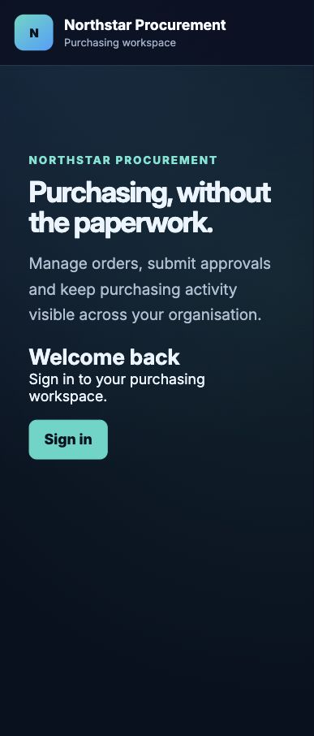

# Northstar Procurement

A deliberately vulnerable procurement application for practising web and API
penetration testing. Northstar looks like a small business application: users
from two organisations review purchase orders, submit approvals and manage
workflows. All accounts and data are synthetic.

Use it with ARTEX, Strix, Burp, ZAP, an API client or manual testing. No testing
tool or LLM service is embedded in the app.

**v0.1.0-rc.2 is a Docker-first public review candidate.** See the
[release notes](docs/RELEASE_NOTES.md) for verification status and limitations.
Do not expose this intentionally vulnerable app to the public Internet or put
real data in it. The Fixed profile corrects the seeded exercises; it does not
make Northstar production-ready.



*Northstar's current landing page, shown at a narrow browser width. The local
Docker lab uses the same application screens.*

## Why practise on Northstar?

[Wiz Research's report on ARTEX-associated activity overlapping Storm-0940](https://www.wiz.io/blog/artex-in-the-wild-storm-0940-expands-targeting-of-it-and-software-vendors)
describes a repeatable progression: map an application and its APIs, probe
authentication, then test whether tenant boundaries hold. Northstar gives
defenders a controlled way to practise the safe counterpart: observe the SPA
and API, sign in with synthetic accounts, compare Alice's and Bob's access,
save evidence, and verify a fix with a fresh retest.

The lab does **not** recreate that campaign or its real identity providers,
password spraying, account-recovery abuse or IP rotation. The point is to learn
and rehearse an evidence-led process before facing similar patterns on an
authorised system. Follow the [ARTEX-to-Strix walkthrough](docs/ARTEX_TO_STRIX_RETEST_TUTORIAL.md)
for one bounded example.

## Start locally

You need Docker with Compose v2.24 or newer, Python 3.9 or newer, and Git if
cloning the repository. Docker Desktop or Docker Engine with Compose works;
the first build needs Internet access to download project dependencies.

Download the curated ZIP from this repository's **Releases** page and extract
it, or clone the repository with GitHub's **Code** button. The ZIP is the
recommended starting point for the Docker-only exercise.

From the extracted project or checkout root:

```bash
cp .env.example .env
python3 owner-control/configure_owner.py
docker compose up --build -d
```

These are first-install commands. Preserve existing environment files and
volumes when updating. Choose a separate owner password of at least 16
characters when prompted; it is not a synthetic application password.

Open:

- [Northstar](http://localhost:8080) — the application under test.
- [Owner reference](http://localhost:8081/demo) — sign in as `owner` with the
  password you chose; includes accounts and profile controls.
- [User guide](docs/USER_GUIDE.md) — users, organisations and normal journeys.

Use **localhost**, not a different hostname: the browser origin, OAuth issuer
and callback must match. By default the app, owner page and direct API origin
are bound only to the Docker host's loopback interface.

Check readiness:

```bash
docker compose ps
curl --fail --silent --show-error --max-time 10 http://localhost:8080/api/health
```

Then complete a normal sign-in and open an order. A successful health check
alone does not verify browser authentication.

## Try the ARTEX and Strix walkthrough

Start with [From discovery to verified fixes with ARTEX and Strix](docs/ARTEX_TO_STRIX_RETEST_TUTORIAL.md).
It begins with a small Alice-only login/API check before the two-account
discovery task. That first checkpoint helps distinguish connectivity or model
budget problems from application findings.

Explore one cross-organisation access-control case, turn the evidence into a
reviewed brief, then use two fresh Strix runs to check the same case in
Vulnerable and Fixed modes. The walkthrough uses public tool interfaces, not
a private launcher or model catalogue. Readers supply their own model access
to their chosen testing tools.

The [local testing setup](docs/LOCAL_TESTING_SETUP.md) explains how a tool's
container reaches Northstar without publishing the lab to the LAN. The
[companion article](docs/blog/ai-assisted-pentesting-discovery-to-retest.md)
compares the two tools and explains the handoff.

## Architecture

```text
Browser -> Nginx gateway -> Angular static assets
                        -> Spring Boot API + OAuth/OIDC identity provider
                             |-- SQLite business and identity stores
                             |-- simulated approval workflows
                             `-- Unix socket -> isolated export worker

Owner browser -> separate owner-control service -> vulnerability profile
```

This is a multi-tier SPA and API lab. Nginx is the local gateway, not a complete
API-management product. Business and identity logic share one Spring Boot JVM;
the workflow engine is simulated, not an independently deployed microservice.
The export worker is a separate non-root container with no IP network.

Authentication uses Spring Authorization Server, authorization code with PKCE,
OIDC and bearer access tokens. The SPA keeps its token state in sessionStorage.
Application records, identity records and signing keys use separate persistent
volumes. See [lab operation and authentication](docs/LAB_OPERATIONS.md).

The full source checkout also contains optional AWS Terraform deployments:
a single-EC2 stack and a CloudFront/S3/API Gateway/ALB/EC2 variant. They are
outside this Docker release candidate and its walkthrough; no AWS account,
domain, VPN or hosted Northstar instance is needed.

## Vulnerable and Fixed modes

Fresh installations start **Vulnerable**, with 17 exercise switches enabled.
In the separate owner page, choose **Disable all — Fixed**, **Enable all —
Vulnerable**, or an individual combination. Network containment and management
authentication are not disabled by these switches.

The exercises cover access control, role-header trust, gateway routing, CORS,
workflow logic, database disclosure, SQL injection, PKCE, stored XSS, supplier
script integrity and command injection. SSRF is deliberately simulated without
outbound requests; command execution is contained in the isolated worker.

The [known-vulnerability catalogue](docs/KNOWN_VULNERABILITIES.md) explains the
expected findings and their limits. **It contains spoilers**: do not give it,
the source or the OpenAPI schema to a tool during a blind black-box assessment.

Keep owner credentials and reset secrets out of scanner prompts and input files.
Switching profiles does not reset data or revoke sessions; use fresh browser
contexts when comparing behaviour.

## Stop, restart and reset

Stop without deleting persistent state:

```bash
docker compose down
```

Restart with `docker compose up -d`. Use the
[reset instructions](docs/LAB_OPERATIONS.md#resetting-the-lab) when deliberately
restoring seed data. Reset can delete evidence and changes made by other testers,
so coordinate first. Normal shutdown is not a reset.

## Project layout

| Path | Purpose |
|---|---|
| `frontend/` | Angular SPA |
| `gateway/` | Local Nginx gateway |
| `backend/` | Spring API, identity provider and SQLite persistence |
| `export-worker/` | Isolated command-injection exercise |
| `owner-control/` | Separate owner reference and profile controls |
| `openapi/` | API schema for non-blind assessments |
| `scripts/` | Local connectivity helper and release checks |
| `docs/` | Tutorial, operations guide, templates and exercise catalogue |

## Release and contributions

This candidate is for public review and is licensed under
[Apache-2.0](LICENSE); see [NOTICE](NOTICE). It is not a production release.
ARTEX and Strix are separate projects with their own licences
and installation procedures.

Keep issue reports free of tokens, owner passwords, session files and live
deployment details. Use synthetic reproduction steps, identify the release
and selected vulnerability profile, and distinguish intended exercises from
unexpected defects.
