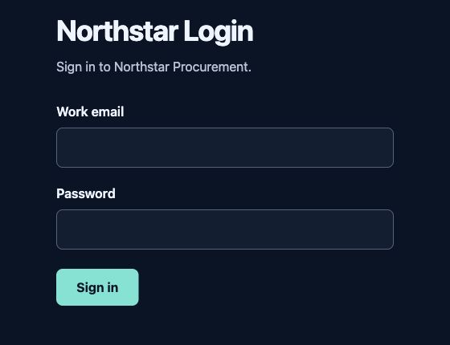
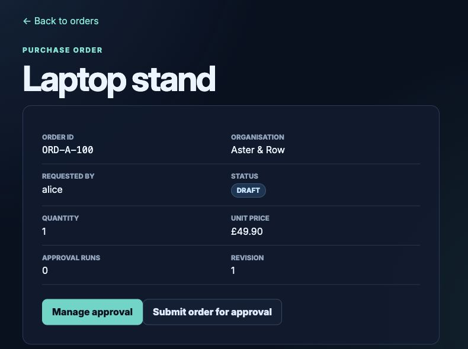

# Northstar Procurement user guide

Northstar Procurement is the business-facing application inside the Deep Cyber security lab.
It behaves like a small purchasing portal: users sign in under an organisation, review purchase
orders, and start approval requests. Administrators also receive an operations overview.

All names, organisations, orders, credentials, and financial values are synthetic. Do not enter
real personal, customer, or company data.

## Open the application

Start the Docker Compose stack as described in the [quickstart](../README.md)
and open <http://localhost:8080>.
Choose **Sign in**, then enter your email/password on **Northstar Login**.
You return to your orders after the OAuth callback.
See [authentication and session behaviour](LAB_OPERATIONS.md#authentication-and-browser-state).

*Northstar Login before entering credentials; no password is pictured.*

## Demo accounts

Every account uses the synthetic password `Welcome123!`.

| Name | Email | Organisation | Access |
|---|---|---|---|
| Alice Avery | `alice.avery@aster-row.test` | Aster & Row | Standard user |
| Alex Archer | `alex.archer@aster-row.test` | Aster & Row | Standard user |
| Ada Morgan | `ada.morgan@aster-row.test` | Aster & Row | Administrator |
| Bob Baker | `bob.baker@beacon-works.test` | Beacon Works | Standard user |
| Ben Carter | `ben.carter@beacon-works.test` | Beacon Works | Administrator |

Enter an account's email and password on the Northstar Login form. Use separate
browser profiles when comparing users. Sign out before switching users in the same profile.

## Main journeys

### Review purchase orders

1. Sign in as a standard user.
2. Open **Orders**.
3. Review the orders shown for the account.
4. Open an order to see its quantity, value, status, requester, and approval history.

*Example order detail for Alice's synthetic account. Your order values may
differ if the lab has been changed or reset.*

### Submit an approval request

On **Orders**, use **Search items** to filter by item description. Open a draft
order and select **Submit order for approval** to change its status to
`PENDING_APPROVAL`. This status change does not itself start a workflow.
The workflow journey below creates and tracks a separate approval execution.

1. Open **Workflows**.
2. Choose an order.
3. Select **Submit for approval**, **Cancel**, or **Review**.
4. Select **Submit request**.
5. Use **Check status** to retrieve its latest state.

### View administration metrics

1. Sign in as Ada Morgan or Ben Carter.
2. Open **Admin**.
3. Review the user, order, approval, and order-value totals.

The Admin navigation item is not displayed for standard users.

### Change user

Select **Sign out** in the top-right corner, then sign in with another demo account. For clean
security-test evidence, use separate private browser windows or browser profiles for each account.

## Security-testing documentation

Data now persists across backend restarts. Lab operators can restore the
synthetic dataset using the separately protected reset API described in
[lab operation and reset](LAB_OPERATIONS.md#resetting-the-lab). A reset discards test changes
for all users; save evidence and stop active tests first.

The normal application screens do not reveal the intended findings. Authorized testers should use
[the ARTEX and Strix walkthrough](ARTEX_TO_STRIX_RETEST_TUTORIAL.md) for a bounded
assessment procedure. Consult the [known-vulnerability catalogue](KNOWN_VULNERABILITIES.md)
only after completing the blind pass; it contains spoilers.
